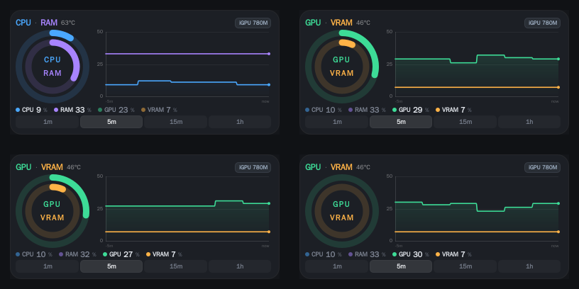

# Resource Panel

一个 KDE Plasma 6 面板小部件，以成对的同心圆环显示 **CPU / RAM** 与 **GPU / VRAM**，并在下方绘制当前一对的历史曲线。



*左上：CPU+RAM · 右上：GPU+VRAM · 左下：稳定后的 GPU+VRAM ·
右下：切换中途定格，弧线收回，轨道已换上新配色。*

## 安装

原生插件必须放进 Qt 自己的 QML import 目录：Qt 解析 `import` 时参照它的安装前缀（以及 app 目录 / `qrc:`），而 KDE 包无法携带编译好的模块。小部件包本身按用户安装。

```sh
make install      # 编译插件、安装插件、安装小部件
kquitapp6 plasmashell && kstart plasmashell
```

然后在面板上右键 → *添加部件* → 搜索 **Resource Panel**。

请以你自己的用户身份运行——绝不要 `sudo make install`。小部件是按用户安装的包，目标路径来自 `$HOME`，在 sudo 下会装进 root 的家目录，而你的 plasmashell 根本不会去那里找。只有 QML 插件需要 root，脚本会自己提出请求。

`make install` 只在 QML 目录不可写时才要求 `sudo`，并在报告成功之前用 `kpackagetool6 --list` 校验结果。

## 卸载

```sh
make uninstall    # 或 scripts/uninstall.sh
kquitapp6 plasmashell && kstart plasmashell
```

卸载走 CMake 安装清单，因此精确删除当初添加的两个文件——`libresourcepanel.so` 和 `qmldir`——然后仅在该目录为空时才清理模块目录。小部件包用 `kpackagetool6` 移除。脚本可以安全地重复执行，对已经不存在的文件会如实报告而不是报错。

要在不重启面板的情况下预览 UI 改动：

```sh
make preview        # 把四种状态离屏渲染到 test/states.png
make preview-light  # 同样的四种状态，走浅色配色
```

外观跟随系统配色方案：浅色主题下卡片为白色、文字转深，深色主题下保持原来的近黑卡片；
四个指标的色相不变，浅色下加深以保证圆环标签的可读性。无需手动设置。

## 配置

`contents/config/main.xml` 持久化分组和时间范围，小部件会按上次离开时的视图重新打开。设置页还可以选择启动时的默认分组和历史窗口。
